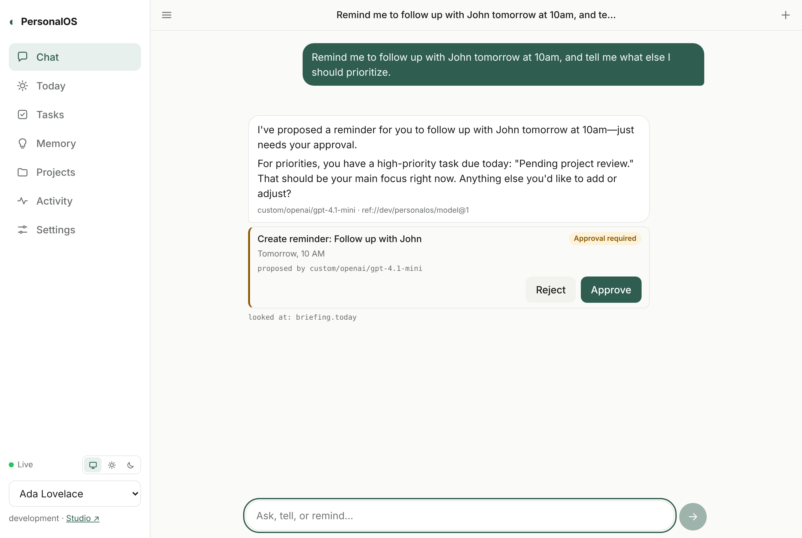
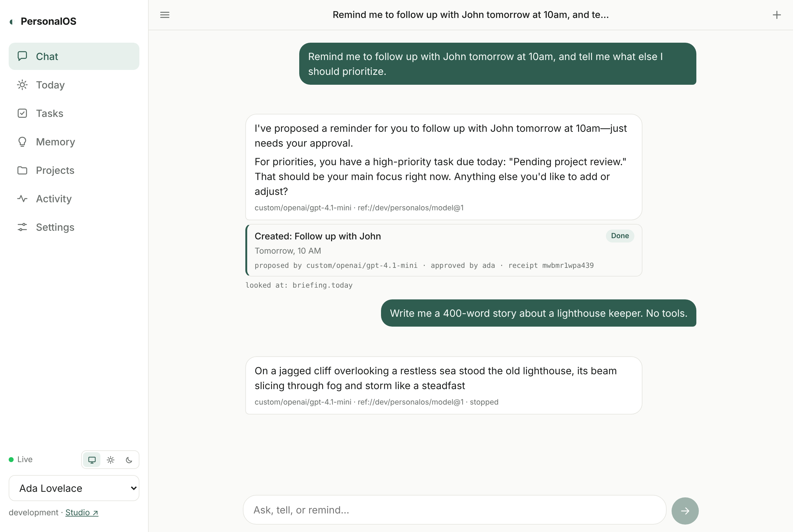

# PersonalOS

A personal assistant built on [FeltKit](https://www.npmjs.com/package/@feltdb/feltkit). Talk to it the way you would to a person. It answers in its own words, streamed, and it keeps track of your tasks, reminders and the things you tell it. It works through the same capabilities you use, and it never changes anything without your approval. Every reply, proposal, approval and execution is recorded with the evidence behind it.

> The assistant is intelligent, but the system is dependable. The model is not the product. The memory, conversations, tasks, permissions and evidence are, and they survive a model change.

<p>


</p>

## How a turn works (FeltKit M1)

`feltkit/turn.ts`, one `app.action` per message:

1. **Record the message.** It is idempotent by the client's message id, so a retried send is the same turn.
2. **Open the turn's agent task.** It is keyed by the message, and it is where all of the turn's evidence lives.
3. **Generate.** `ctx.model.generate` streams to the UI as the model writes. The model comes from the environment (Studio → Models, or a Resolver reference), never from the app. The model sees the conversation, open tasks and confirmed memories. Its tools are PersonalOS capabilities: `tasks.create/update/complete/list`, `memory.add/list`, `briefing.today`, `projects.list`.
4. **Tool calls are proposals.** Reading tools run immediately, and their results go back to the model, which is how it can actually tell you what to prioritize. Changing tools wait for your approval in the chat. The app, not the model, fills in your time zone offset and today's date.
5. **Approval runs it.** The action runs server-side through AppPort as you, exactly once. The card shows who proposed it (the model), who approved it, and the receipt.
6. **The reply is recorded** with its task, generation records and proposals. A provider failure still ends with a reply that says what happened.

**With the model off** (Settings) or none configured, the same turn runs the deterministic assistant (`feltkit/assistant.ts`): the built-in interpreter for tasks, reminders, memory and the briefing.

## Run it

```bash
npm install
npm run dev          # prints the app URL and Studio (the FeltKit dashboard)
```

In development you're signed in as Ada (owner + admin). Grace is a second owner, so you can check that people never see each other's data. Guest is read-only. State lives in `.feltkit/development/state`, a local FeltDB instance, and survives restarts.

## What works

| Area | What you can do | Where |
|---|---|---|
| Chat | Multiple threads; history persists; edit a message (the old turn is kept, marked superseded) or ask again; suggested follow-ups; each reply shows the actions it reports, with status and evidence | `feltkit/assistant.ts`, `src/chat.tsx` |
| Tasks & reminders | "Remind me to follow up with John tomorrow at 10am", "add X to my list, it's urgent", "move that task to Friday", "mark the report done", "every Monday at 8am". A reminder is a real AppPort Services job at that time; it sends a notification. Recurring tasks schedule their next occurrence when completed | `feltkit/_ops.ts`, `feltkit/reminders.ts` |
| Memory | "Remember that Sam is my manager" is stored as **confirmed**. "I prefer afternoon meetings" (volunteered, not asked) is stored as **inferred**: hedged on recall and never treated as fact until you confirm it. Every memory has provenance (conversation, message, quote) and timestamps; inspect, edit, confirm or forget it on the Memory tab | `feltkit/memory.ts` |
| Your day | "What should I focus on?", "what am I forgetting?", "help me plan my week"; the Today tab; an optional daily check-in and weekly review (day and time you choose), each posted to its own thread by a scheduled job | `feltkit/_briefing.ts`, `feltkit/checkins.ts`, `feltkit/weekly.ts` |
| Projects | Create projects, attach tasks, ask "status of …" (open/done tasks and related memories) | `feltkit/projects.ts` |
| Files | Upload documents (10 MB each), attach them to a project, download through a short-lived link, delete. Bytes live in AppPort Services Files in the same FeltDB instance, owned by you; the assistant can list them (`documents.list`) but not read or delete them | `feltkit/documents.ts` |
| Outbound events | `task.completed`, `reminder.fired` and `document.added` are emitted to webhook endpoints an operator registers in Studio → Webhooks (signed, retried, with history) | `feltkit/_ops.ts`, `feltkit/reminders.ts` |
| Chrome extension | The assistant in Chrome's side panel beside any page: sign in with your account, same data as the web app; summarize or ask about the page, save it to Files, add a task from a selection or link. Build with `npm run extension:build` | `extension/`, [extension/README.md](extension/README.md) |
| Activity | Every change made or proposed: what, how (chat, UI, job, model), status, and the record it was verified against. Approve or reject proposals here or inline in chat | `feltkit/actions.ts` |
| Model | On by default when a model is configured: replies are written by the model, streamed, cancellable (Stop). Switch models in Studio → Models, `feltkit model set`, or a Resolver reference (`ref://prod/personalos/model`; in development `PERSONALOS_MODEL_REF`), with no restart. Settings shows which model is in use | `turn.ts`, `turnstate.ts` |

## How it works

Each message is one mutation, and therefore one FeltDB transaction:

1. **Understand.** `interpret()` is a deterministic parser that turns the message into an intent with slots and a list of missing information. It's pure and unit-tested.
2. **Ask instead of guess.** A missing time ("remind me to call mom") or an ambiguous reference ("which task?") gets a question, and nothing changes.
3. **Authorize.** FeltKit roles decide what the caller may do on every interface. Every record is owned, and `own()` refuses another person's record as `NOT_FOUND`.
4. **Plan.** Run the operation directly when you asked for it explicitly and it's reversible. Otherwise **propose** it (delete a task, forget a memory) and wait for your approval.
5. **Execute → verify → record.** Operations in `feltkit/_ops.ts` are the only code that changes state. Each one reads its record back inside the transaction and writes an `actions` row citing the collection, id, and version. The change and its evidence commit together or not at all.
6. **Report.** The reply is composed from those rows and cites their ids, so it can't claim what didn't happen.

Effects outside the transaction (reminder jobs, notifications, the model decision) use FeltKit's `ctx.afterCommit` / `ctx.agent.start`. They happen only if the transaction commits, and they run as you.

**Ownership of state.** Conversations, messages, memories, tasks, projects, the action log, and settings are FeltDB collections in this app's one instance. Reminders and check-ins are AppPort Services jobs (`reminder.fire`, `checkin.fire`), and notifications are AppPort Services Notifications. Model decisions, proposals, and approvals are FeltKit agent records in FeltDB agent memory. The model's provider, endpoint, and key belong to the environment (Intelligence + credential custody, or Resolver), never to the app.

## What it deliberately doesn't do

- **API keys.** An API key authenticates as its own identity, so anything it created would be owned by the key, not by you. PersonalOS keeps it off until keys can act for a person.
- **Schedules** are enabled for operators (Studio → Schedules). A schedule runs as whoever created it, so per-person recurrence (reminders, check-ins) stays a job chain that runs as you.
- **Email, calendar, messaging, web research.** No integration is configured, so none is offered. The assistant never says it sent or scheduled anything outside this app. These are P2; FeltKit's `app.integration` is the path when they're built.
- **Semantic memory search.** Recall is keyword-based (gap G4).

## Requirements

Until FeltKit's M1 release is published, this branch depends on a sibling checkout: `"@feltdb/feltkit": "file:../feltkit/packages/sdk"` (rkendel1/feltkit, branch `claude/m1-agent-foundation`, built with `npm run build` in `packages/sdk`). Switch it back to the published version once it exists.

## Tests

```bash
npm test             # 25 tests: interpreter, workflows, and model turns on the real runtime and an isolated FeltDB instance
npm run typecheck
```

`tests/assistant.test.ts` follows the definition of done: persistence across `restart()`, cross-conversation recall with provenance, reminders through the real job queue and notifications, the briefing, approvals (including an agent that may only propose), isolation between people, edits, and daily check-ins. `tests/model.test.ts` switches between two OpenAI-compatible model servers through FeltKit's own model selection with a restart in between, then checks that state survives and each decision names its model.

Against the running app, in a real browser:

```bash
npm run dev                                  # in one terminal (default http://localhost:3000)
NODE_PATH=$(npm root -g) node e2e/ui.mjs http://localhost:3000 before .   # chat → memory → reminder → Tasks → Today → approve → Activity
# stop and start `npm run dev` again, then:
NODE_PATH=$(npm root -g) node e2e/ui.mjs http://localhost:3000 after .    # same state after a process restart
NODE_PATH=$(npm root -g) node e2e/model.mjs http://localhost:3000         # switch models live with `feltkit model set`
```

M1 acceptance against the running app, in a real browser, with a real model, and Resolver as its own process:

```bash
NODE_PATH=$(npm root -g) AI_GATEWAY_API_KEY=… node e2e/acceptance.mjs <screenshot-dir>
```

It covers:
- the conversation streaming, with its reminder proposed (approval required) and the priorities named;
- approval in the app, with an execution receipt;
- Stop;
- a Resolver retarget (A → B) with no restart;
- a process restart;
- isolation between two people;
- the model switched off.

`tests/real-provider.test.ts` runs the same conversation against the real model without a browser. Both use OpenAI's model through Vercel AI Gateway (`AI_GATEWAY_API_KEY`), or OpenAI directly (`OPENAI_API_KEY`).

The e2e scripts need Playwright (`npm i -D playwright`, or a global install via `NODE_PATH`).

## Production

`agent.model` names `ref://prod/personalos/model`, so production decides with whatever Resolver binds that reference to (`docs/RESOLVER.md` in the FeltKit package). Model assist is off until a person turns it on. Deploy as described in [docs/FELTKIT-REFERENCE.md](docs/FELTKIT-REFERENCE.md#deploying) (`npx feltkit readiness --env production`, `npm run deploy`). The app uses `ctx.agent`, so it needs a FeltKit server and isn't an AppBoundry artifact.
