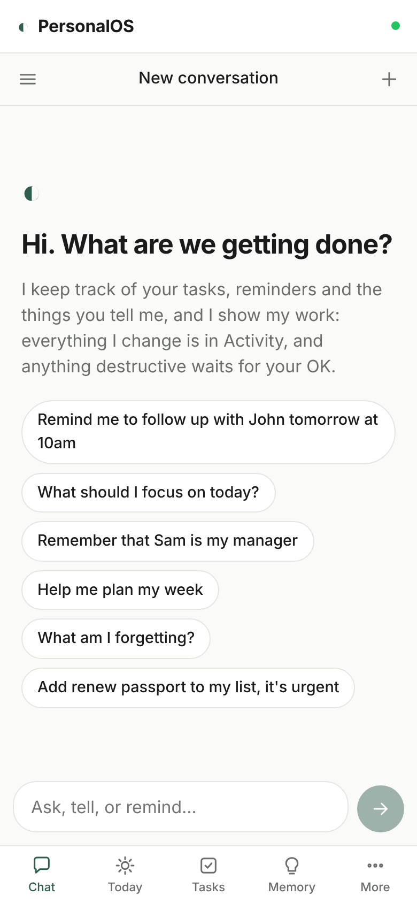
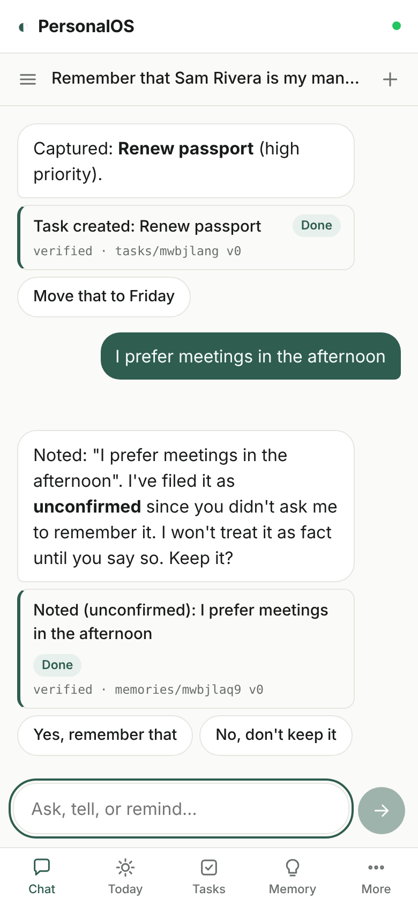
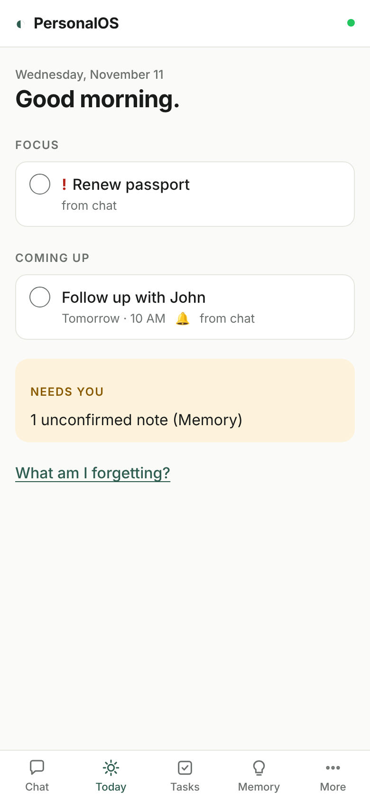
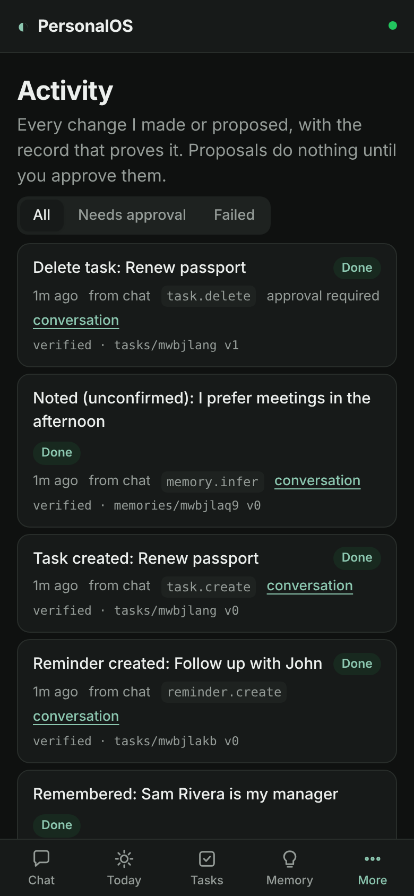

# PersonalOS

A personal assistant built on [FeltKit](https://www.npmjs.com/package/@feltdb/feltkit). You talk to it, and it keeps track of your tasks, reminders, and the things you tell it. It briefs you on your day and shows its work: every change it makes is recorded with the record that proves it, and anything destructive waits for your approval.

> The assistant is intelligent, but the system is dependable. The model is not the product. The memory, conversations, tasks, permissions and evidence are, and they survive a model change.

<p>




</p>

## Run it

```bash
npm install
npm run dev          # prints the app URL and Studio (the FeltKit dashboard)
```

In development you're signed in as Ada (owner + admin). Grace is a second owner, so you can check that people never see each other's data. Guest is read-only. State lives in `.feltkit/development/state`, a local FeltDB instance, and survives restarts.

## What works

| Area | What you can do | Where |
|---|---|---|
| Chat | Multiple threads; history persists; edit a message (the old turn is kept, marked superseded) or ask again; suggested follow-ups; each reply shows the actions it reports, with status and evidence | `feltkit/assistant.ts`, `src/chat.tsx` |
| Tasks & reminders | "Remind me to follow up with John tomorrow at 10am", "add X to my list, it's urgent", "move that task to Friday", "mark the report done", "every Monday at 8am". A reminder is a real AppPort Services job at that time; it sends a notification. Recurring tasks schedule their next occurrence when completed | `feltkit/_ops.ts`, `feltkit/reminders.ts` |
| Memory | "Remember that Sam is my manager" is stored as **confirmed**. "I prefer afternoon meetings" (volunteered, not asked) is stored as **inferred**: hedged on recall and never treated as fact until you confirm it. Every memory has provenance (conversation, message, quote) and timestamps; inspect, edit, confirm or forget it on the Memory tab | `feltkit/memory.ts` |
| Your day | "What should I focus on?", "what am I forgetting?", "help me plan my week"; the Today tab; an optional daily check-in posted to its own thread by a scheduled job | `feltkit/_briefing.ts`, `feltkit/checkins.ts` |
| Projects | Create projects, attach tasks, ask "status of …" (open/done tasks and related memories) | `feltkit/projects.ts` |
| Activity | Every change made or proposed: what, how (chat, UI, job, model), status, and the record it was verified against. Approve or reject proposals here or inline in chat | `feltkit/actions.ts` |
| Model | Optional. When on, a message the rules can't interpret goes to the environment's model, which picks among readings the app offers. Its pick is a proposal you approve; facts it suggests stay unconfirmed. Switch models in Studio → Models, `feltkit model set`, or a Resolver reference in production, with no redeploy | `assistant.ts` (`unknown`), `apply` |

## How it works

Each message is one mutation, and therefore one FeltDB transaction:

1. **Understand.** `interpret()` is a deterministic parser that turns the message into an intent with slots and a list of missing information. It's pure and unit-tested.
2. **Ask instead of guess.** A missing time ("remind me to call mom") or an ambiguous reference ("which task?") gets a question, and nothing changes.
3. **Authorize.** FeltKit roles decide what the caller may do on every interface. Every record is owned, and `own()` refuses another person's record as `NOT_FOUND`.
4. **Plan.** Run the operation directly when you asked for it explicitly and it's reversible. Otherwise **propose** it (delete a task, forget a memory) and wait for your approval.
5. **Execute → verify → record.** Operations in `feltkit/_ops.ts` are the only code that changes state. Each one reads its record back inside the transaction and writes an `actions` row citing the collection, id, and version. The change and its evidence commit together or not at all.
6. **Report.** The reply is composed from those rows and cites their ids, so it can't claim what didn't happen.

Effects outside the transaction (reminder jobs, notifications, the model decision) use FeltKit's `ctx.afterCommit` / `ctx.agent.start`. They happen only if the transaction commits, and they run as you.

**Ownership of state.** Conversations, messages, memories, tasks, projects, the action log, and settings are FeltDB collections in this app's one instance. Reminders and check-ins are AppPort Services jobs (`reminder.fire`, `checkin.fire`), and notifications are AppPort Services Notifications. Model decisions, proposals, and approvals are FeltKit agent records in FeltDB agent memory. The model's provider, endpoint, and key belong to the environment (Intelligence + credential custody, or Resolver), never to the app.

## What it deliberately doesn't do

- **Open-ended chat or model-written replies.** FeltKit 0.3.22 gives apps model *decisions*, not text generation (see [platform gaps](docs/PLATFORM-GAPS.md), G1). Rather than call a provider around the platform's credential custody and receipts, the assistant replies deterministically and says when it can't help.
- **Email, calendar, messaging, files, web research.** No integration is configured, so none is offered. The assistant never says it sent or scheduled anything outside this app. These are P2; FeltKit's `app.integration` is the path when they're built.
- **Semantic memory search.** Recall is keyword-based (gap G4).

## Tests

```bash
npm test             # 20 tests: interpreter + workflows on the real runtime and an isolated FeltDB instance
npm run typecheck
```

`tests/assistant.test.ts` follows the definition of done: persistence across `restart()`, cross-conversation recall with provenance, reminders through the real job queue and notifications, the briefing, approvals (including an agent that may only propose), isolation between people, edits, and daily check-ins. `tests/model.test.ts` switches between two OpenAI-compatible model servers through FeltKit's own model selection with a restart in between, then checks that state survives and each decision names its model.

Against the running app, in a real browser:

```bash
npm run dev                                  # in one terminal (default http://localhost:3000)
NODE_PATH=$(npm root -g) node e2e/ui.mjs http://localhost:3000 before .   # chat → memory → reminder → Tasks → Today → approve → Activity
# stop and start `npm run dev` again, then:
NODE_PATH=$(npm root -g) node e2e/ui.mjs http://localhost:3000 after .    # same state after a process restart
NODE_PATH=$(npm root -g) node e2e/model.mjs http://localhost:3000         # switch models live with `feltkit model set`
```

The e2e scripts need Playwright (`npm i -D playwright`, or a global install via `NODE_PATH`).

## Production

`agent.model` names `ref://prod/personalos/model`, so production decides with whatever Resolver binds that reference to (`docs/RESOLVER.md` in the FeltKit package). Model assist is off until a person turns it on. Deploy as described in [docs/FELTKIT-REFERENCE.md](docs/FELTKIT-REFERENCE.md#deploying) (`npx feltkit readiness --env production`, `npm run deploy`). The app uses `ctx.agent`, so it needs a FeltKit server and isn't an AppBoundry artifact.
