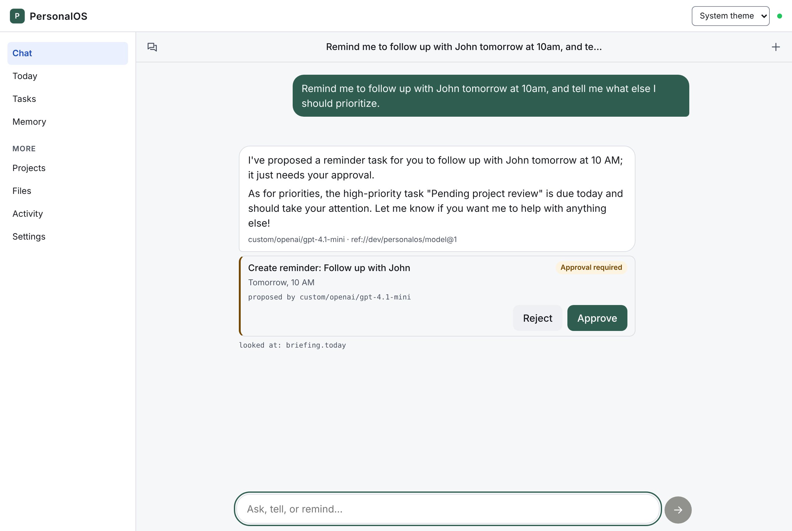
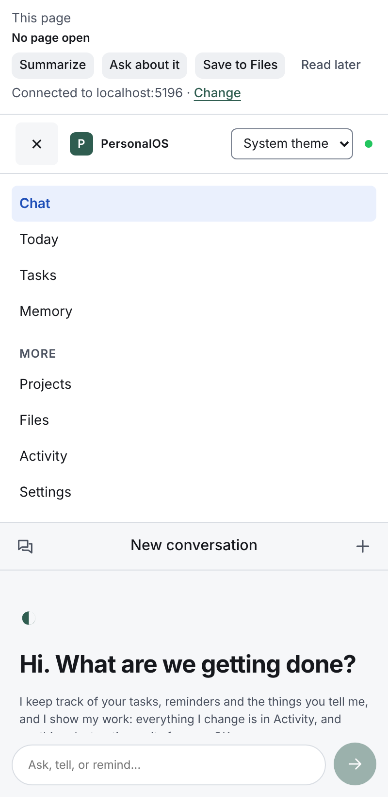
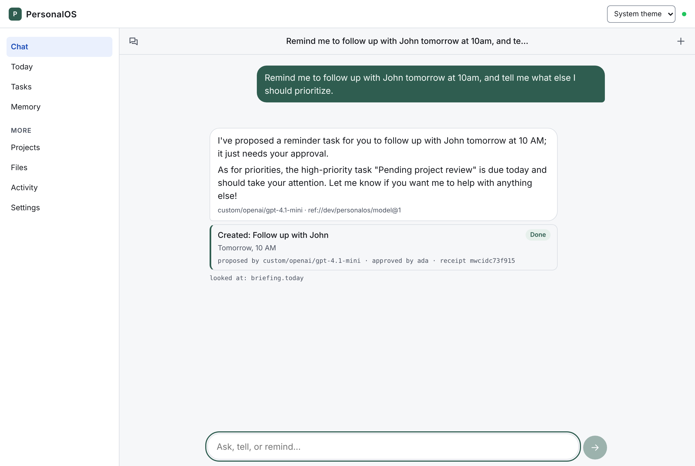
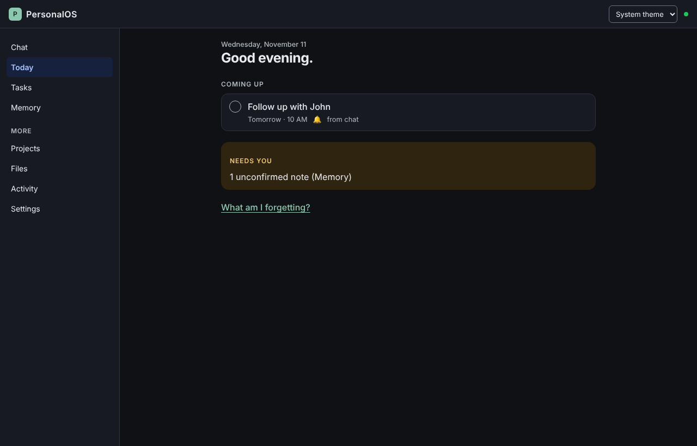

# PersonalOS

**An open-source personal assistant, and a starter for what you can build with
[FeltKit](https://www.npmjs.com/package/@feltdb/feltkit).**

Talk to it like a person. It answers in its own words, streamed, and keeps track of your tasks,
reminders, files and the things you tell it. When it wants to change something, it proposes; you
approve, and you see the receipt. It runs in the browser, on your phone and in Chrome's side panel.

<p>


</p>

> The model is not the product. Your memory, conversations, tasks, permissions and the evidence of
> every change are, and they survive a change of model.

## What you get, and what you'd otherwise build

PersonalOS is a few thousand lines of application code: its app definition, domain operations, a
model turn, the UI and a Chrome extension. Everything underneath is FeltKit:

- a database with transactions and live queries
- accounts, sessions and roles checked on every interface
- an HTTP API with typed clients, plus MCP tools for agents
- background jobs, notifications, files and signed webhooks
- a streamed model call whose key the app never sees
- an agent that proposes and waits for a person to approve
- a development dashboard (Studio)

This repository contains none of:

| You'd usually write or assemble | Here |
|---|---|
| SQL, migrations, an ORM | none |
| A server bootstrap (Express, Fastify …) | none |
| A WebSocket/SSE server for live updates | none |
| A queue, workers, cron | none |
| A model SDK, key storage, streaming plumbing | none |
| An approval workflow and audit store | none |
| A second backend for the browser extension | none |

**[What you write vs what FeltKit gives you →](docs/WHAT-FELTKIT-GIVES-YOU.md)** gives the measured
numbers and goes capability by capability. `npm run measure` reproduces them, and CI checks them.

## Run it (no keys needed)

```bash
git clone https://github.com/rkendel1/personalos my-assistant
cd my-assistant
npm install
npm run dev
```

`npm run dev` prints the app's address and **Studio**, the FeltKit dashboard. You're signed in as Ada,
a development user. Grace is a second person (she never sees Ada's data), and Guest is read-only.
State lives in `.feltkit/development/state` and survives restarts.

Try:

- *Remind me to follow up with John tomorrow at 10am*
- *Remember that Sam is my manager*
- *Add renew passport to my list, it's urgent*
- *What should I focus on today?*

Without a model, a built-in assistant answers these. Tasks, reminders, memory and the briefing all work.

## Turn on the model

In Studio → **Models**, pick a provider and model, paste the API key and press Test. Or use the CLI,
which asks for the key without echoing it:

```bash
npx feltkit model set --provider openai --model gpt-4.1-mini --api-key-stdin
```

FeltKit keeps the key in the environment's credential store; the app never sees it. Replies now stream
from the model. Its tools are the app's own capabilities (`tasks.create`, `memory.add`,
`briefing.today` …). Reading tools run at once. Changing tools become **proposals** that you approve in
the chat. In production, point `ref://prod/personalos/model` at a model with
[Resolver](https://www.npmjs.com/package/@appport/resolver) to switch models without a redeploy.



## What it does

| Area | What you can do | Code |
|---|---|---|
| Chat | Threads that persist, a streamed reply you can stop, editing a message (the old turn is kept), and actions shown with their evidence | `feltkit/turn.ts`, `src/chat.tsx` |
| Tasks and reminders | "every Monday at 8am", "move that to Friday", "mark the report done". A reminder is a real background job that notifies you, and runs as you | `feltkit/_ops.ts`, `reminders.ts` |
| Memory | What you ask it to remember is **confirmed**. What you only mention is **inferred**, and it isn't treated as fact until you confirm. Each memory keeps where it came from | `feltkit/memory.ts` |
| Your day | Today, "what am I forgetting?", an optional daily check-in and weekly review | `feltkit/_briefing.ts`, `checkins.ts`, `weekly.ts` |
| Projects and files | Group tasks, ask "status of …", upload documents (10 MB) and get short-lived links | `feltkit/projects.ts`, `documents.ts` |
| Activity | Every change made or proposed: how, by whom, and the record it was verified against | `feltkit/actions.ts` |
| Webhooks | `task.completed`, `reminder.fired` and `document.added`, signed and retried, to endpoints you register in Studio | `feltkit/_ops.ts` |
| Chrome extension | The same app in the side panel: ask about the page, save it to Files, add a task from a selection | [`extension/`](extension/README.md) |
| Agents | 13 capabilities published over AppPort and MCP, under the same permissions as the UI | `capability:` in `feltkit/*.ts` |

## PersonalOS Anywhere

Mention @personalos in another app (the first is [Multiplayer](https://github.com/rkendel1/multiplayer))
and it works here, in your account. Resolver resolves who is asking, AuthBoundry decides what they may do,
and shared conversations never get your private data. You choose what it may do for you in Settings;
AuthBoundry comes with PersonalOS, with nothing to set up. Approvals stay here. See
[docs/ANYWHERE.md](docs/ANYWHERE.md) and the contract, [docs/INTERACTION-CONTRACT.md](docs/INTERACTION-CONTRACT.md).

Share to PersonalOS from iOS (Safari or any app): a page, selected text or a text document, with what
to do with it ("research this company: could it be a customer for FeltKit?"). The share sheet submits
with your own session and closes; PersonalOS does the work later, under your AuthBoundry delegation, and
the result waits in the app. See [docs/IOS-SHARE.md](docs/IOS-SHARE.md) (the app is in `ios/`) and the
contract, [docs/INVOCATION-CONTRACT.md](docs/INVOCATION-CONTRACT.md).

## Tour of the code

```
feltkit/app.ts        the app: roles, services, model reference, collections
feltkit/_ops.ts       the only code that changes state. Each operation writes its evidence
feltkit/turn.ts       one chat turn: generate (streamed), tools, proposals
feltkit/*.ts          queries and mutations per area (tasks, memory, reminders, …)
feltkit/assistant.ts  the built-in assistant when there's no model (with _interpret.ts, _dates.ts)
src/                  the React app (useQuery, useMutation, useAction) in the stack-ui Shell
extension/            the Chrome side panel: the same React app over a bearer session
tests/                the app on the real runtime and an isolated database
e2e/                  real-browser acceptance: web app, extension, real models
```

## Make it yours

- **Rename it**: `name` in `feltkit/app.ts` and `name` in `package.json`.
- **Add data**: `app.collection(...)` in `feltkit/app.ts`, then `app.query`/`app.mutation` in a new
  file. `npm run dev` picks it up, regenerates `api.*`, and Studio shows the data.
- **Give agents a capability**: add `capability: { name, description }` to a function. It's then an
  AppPort capability and an MCP tool, with the same permission checks.
- **Let the model use it**: add its name to `TOOLS` in `feltkit/turn.ts`. Reading capabilities run at
  once and their results go back to the model. Changing ones become proposals the person approves.
- **Drop the built-in assistant** if you'll always have a model: it's `assistant.ts`, `_interpret.ts`
  and `_dates.ts`, which `turn.ts` falls back to when no model is configured.

## Test

```bash
npm test            # the app on the real runtime: workflows, isolation, restarts, model turns
npm run typecheck
npm run measure     # what the app is made of (feltkit measure); measure.json keeps it
```

Real-browser acceptance needs Playwright (`npm i -D playwright`):

```bash
npm run e2e:extension                                         # the Chrome extension, 14 scenarios
node e2e/ui.mjs http://localhost:3000 before <dir>            # the web app (with `npm run dev` running)
AI_GATEWAY_API_KEY=… node e2e/acceptance.mjs <dir>            # real models through Resolver
```

## Deploy

```bash
npx feltkit readiness --env production    # what is still missing
npm run deploy                            # container (default), fly, vercel, cloudflare, …
```

FeltKit's own documentation ships with the package: `npx feltkit docs` lists it (architecture,
guarantees, auth, deployment). PersonalOS uses FeltKit's agent, so it runs on a FeltKit server.

## Design

The UI is built on [stack-ui](https://github.com/rkendel1/stack-ui) (MIT), the `@stack-ui/*` packages from
npm, pinned to one release. The Shell gives a sidebar on wide screens and a
menu on phones and in the side panel. Light and dark follow your system or your choice.



## Limitations

Memory recall is keyword-based. No email or calendar integrations yet. Model features need a
provider. See [docs/LIMITATIONS.md](docs/LIMITATIONS.md).

## License

[MIT](LICENSE)
